<!-- ========================================================= -->
<!--              TARUN GUDAPATI · PROFILE README              -->
<!-- ========================================================= -->

<p align="center">
  
</p>

---

<h1 align="center">
  
</h1>

<p align="center">
  
</p>

---

## `> whoami`

I build production software end to end — .NET services on the back, Angular on the front, and I design the thing so it doesn't look like a 2009 admin panel.

Two years in, my work has gone live in **fintech, HR, and inventory** systems. Real users, real money, real consequences when it breaks. That taught me more about performance, edge cases, and boring reliability than any tutorial could.

<sub>Software engineer at **Safe Financials** (fintech) · previously Ample Logic · Hyderabad, IST</sub>

**How I work:** I don't wait for a ticket to tell me something's broken. I find it, scope a fix, ship it, and move on. Same energy at 6 AM as at 11 PM.

---

## `> cat ~/.services`

<table>
<tr>
<td width="50%" valign="top">

### Engineering
- **.NET backends** — REST APIs, EF Core, clean architecture, async pipelines
- **Angular front-ends** — dashboards, complex forms, internal tools
- **Full-stack features** — DB schema through to the button someone clicks
- **AI / LLM integration** — wiring Claude and similar APIs into products that already exist
- **SQL performance work** — schema design, query tuning, fixing the page that takes 9 seconds

</td>
<td width="50%" valign="top">

### Design & Creative
- **Brand and social creatives** — posters, launch graphics, campaign sets
- **Photo editing** — retouching, compositing, cleanup
- **UI polish** — taking a product that *works* and making it look like someone cared
- **Pitch and deck design** — slides that actually land

</td>
</tr>
</table>

> Most dev shops hand you working software that looks unfinished. Most designers hand you a mockup nobody can build. I do both sides, so nothing gets lost in the handoff.

---

## `> tech --stack`

<p align="center">
  
</p>

<details>
<summary><b>Honest skill breakdown</b> — what I'd actually be comfortable owning</summary>
<br>

```text
C# / .NET        ██████████████████████    daily driver   — EF Core, DI, clean arch, async
Angular / TS     ████████████████████      daily driver   — RxJS, reactive forms, components
SQL Server       ██████████████████        solid          — schema design, query tuning
LLM integration  █████████████████         shipped it     — Claude API, prompt caching, queues
Design / Adobe   ████████████████████      strong         — posters, creatives, photo editing
Docker / CI      █████████████             working on it  — compose, multi-stage builds
System design    ██████████████            growing        — DDD, event-driven patterns
DSA              ████████████████          daily grind    — the LeetCode habit
```

No "expert" labels here. Two years in, I know what I can own and what I'd need a week to get good at — and I'd rather tell you upfront than oversell.

</details>

---

## `> ls ~/work --shipped`

```bash
fintech/
├── lending-platform/     # loan origination, end to end — .NET + Angular
├── ai-assessment/        # LLM-driven analysis of financial documents
└── internal-tooling/     # automation that removed manual ops work

hr/
└── hrms/                 # full HR management system

operations/
└── inventory/            # stock and warehouse management

practice/
└── dsa/                  # daily problem solving
```

---

## `> systemctl status metrics`

<p align="center">
  
  
</p>

<p align="center">
  
</p>

<p align="center">
  
</p>

<sub align="center">Most of my production work lives in private repos, so this graph undersells it. Ask me and I'll walk you through what I've built.</sub>

---

## `> cat ~/.edge`

The part that isn't on a résumé:

- **I can explain the thing.** Non-technical stakeholders leave my calls knowing what we're building and why. That's rarer than it should be.
- **I read the room.** I catch the objection someone hasn't said out loud yet, in a client call or a code review.
- **I have an eye.** Years of design work means I notice the spacing, the hierarchy, the thing that feels off — and I can fix it myself.
- **I close.** Persuasion is a craft. I've learned it the same way I learned .NET: reps.
- **I show up.** Gym before work, code after. The consistency is the whole strategy.

---

## `> hire --me`

I'm open to **freelance and contract work** (roughly 3 PM–11 PM IST, weekdays and Saturdays) and I'll always hear out a strong **full-time** conversation.

**Good fits:** .NET or Angular feature work · adding AI to an existing product · SQL performance rescue · design retainers · a build that needs one person who can do both

<p align="center">
  <a href="https://linkedin.com/in/tarun-gudapati"></a>
  <a href="mailto:tarungudapati30@gmail.com"></a>
</p>

---

<p align="center">
  
</p>

<p align="center">
  <code>$ exit</code><br>
  <sub>Build it. Ship it. Make it look good.</sub>
</p>
